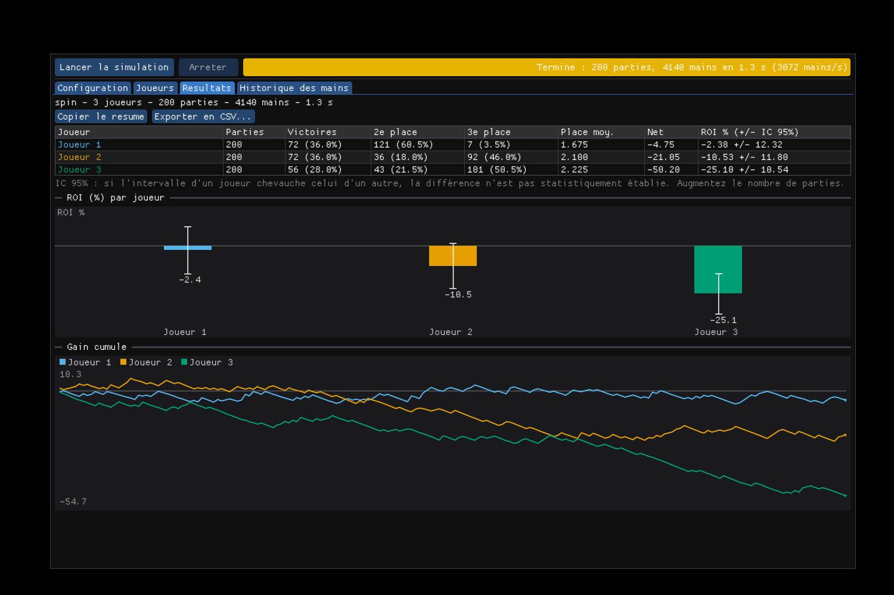

# PokerSim (C++20)

Simulateur Hold'em No Limit moderne : **Cash**, **SNG** (2 à 10 joueurs, blinds montantes au temps ou aux mains)
et **Spin & Go** (multiplicateurs). Objectif : faire jouer entre eux des profils OpenHoldem
(`.ohf` OpenPPL / OH-script, `.oppl`, `.txt`) avec les symboles OpenHoldem recalculés nativement (dont `prwin`).

## Compiler sous Windows (Visual Studio 2022)

**Le plus simple** : double-cliquer sur `PokerSim.sln`, choisir la configuration **Release | x64** (la configuration Debug est
très lente), puis `F5` (le projet de démarrage est `PokerSimGui`). Aucune dépendance à installer : Dear ImGui est fourni.
Ou sans ouvrir Visual Studio : `build_windows.bat` compile et lance l'interface ; `run_tests.bat` lance les tests.

Les exécutables sont dans `bin\Release\` : `pokersim_gui.exe` (interface), `pokersim.exe` (ligne de commande), `ohdump.exe` (diagnostic de profils).
Les projets `vs\*.vcxproj` sont générés par `python tools/gen_vs.py` (à relancer si vous ajoutez un fichier `.cpp`) ; ils ciblent le
toolset v143 (VS 2022) — pour VS 2019, remplacer `v143` par `v142`.

Avec CMake (Windows, Linux, macOS) :

    cmake -S . -B build -G "Visual Studio 17 2022" -A x64      # ou -G Ninja
    cmake --build build --config Release
    ctest --test-dir build -C Release

## Interface graphique

`pokersim_gui.exe` (Windows, Direct3D 11, Dear ImGui) :
- **Configuration** : format (cash, SNG, Spin & Go), nombre de joueurs, blinds fixes ou montantes (tableau éditable, au temps ou aux mains),
  répartition des gains, multiplicateurs Spin & Go (avec retour théorique), rake, graine, threads, plafond d'itérations de `prwin`.
- **Joueurs** : bot intégré ou profil OpenHoldem (`.ohf`, `.oppl`, `.txt`) avec bouton **Vérifier** (format détecté, erreurs de syntaxe).
- **Résultats** : classement, ROI ou bb/100 avec **intervalle de confiance à 95 %**, histogramme, gain cumulé, symboles inconnus, export CSV.
- **Historique des mains** : relecture main par main des premières parties.
- Simulation en tâche de fond avec bouton **Arrêter** (résultats partiels conservés) ; réglages sauvegardés dans `pokersim_gui.json`.

## Historique complet des mains (fichier texte)

    pokersim --format cash --players 6 --games 20 --hands 5000 --hh mains.txt          # toutes les mains
    pokersim --format spin --players 3 --games 500 --hh mains.txt --hh-games 50        # 50 premières parties seulement

Dans l'interface : Configuration > Historique des mains > « Ecrire TOUTES les mains dans un fichier texte ».
Le fichier est écrit au fil de la simulation (mémoire constante), parties **dans l'ordre** même en multithread, en UTF-8 avec BOM.
Pour chaque main : sièges et cartes de **tous** les joueurs, mises forcées (antes, blinds), chaque action avec ses montants (all-in signalés),
pot à chaque street, showdown et combinaisons, pots principal et annexes, mise non payée rendue, rake, résumé par joueur (misé, ramassé, net, stack final),
puis le classement de la partie. Les invariants (total misé = pots + mises rendues + rake ; pot du préflop = mises forcées) sont vérifiés par les tests.

## PokerTracker simulé

Les profils OpenHoldem lisent des statistiques sur leurs adversaires (`pt_vpip3`, `pt_pfr_raischair`…). PokerSim les calcule à partir des mains
jouées, avec les **définitions de PokerTracker 4** (colonnes `flg_*` / `cnt_*`, y compris la définition des « occasions », cf. `PokerTracker_Query_Definitions`).

    pokersim --format cash --players 6 --games 20 --hands 5000 --pt-show --pt-save base.json     # construit une base
    pokersim ... --pt-db base.json                                                              # les profils connaissent déjà leurs adversaires
    pokersim ... --pt-db base.json --pt-save base.json                                          # la base s'enrichit à chaque simulation

- **Symboles** : `pt_<stat><siège 0-9>` et `pt_<stat>_<rôle>chair` (`raischair`, `headsupchair`, `smallblindchair`, `bigblindchair`, `dealerchair`,
  `cutoffchair`, `userchair`, `firstraiserchair`, `firstcallerchair`, `lastcallerchair`). Valeur en fraction de 0 à 1 (AF : ratio), **-1 sans donnée**, comme OpenHoldem.
- **44 statistiques** : hands, vpip, pfr, rfi, wtsd, wssd, steal_attempt, bb/sb_fold_to_steal, 3bet, fold_to_3bet, 4bet, fold_to_4bet, 3bet_vs_steal (+bb/sb),
  fold_to_resteal, preflop_called_raise, preflop_squeeze, fold_to_pf_squeeze (+as_raiser/as_caller), flop/turn/river/total_af et _afq, flop/turn/river_seen,
  flop_cbet, turn_cbet, flop/turn/river_fold_to_cbet, flop_raise_cbet, flop/turn_checkraise, turn_checkcall, flop_donkbet, river_bet.
- **Identité** = nom du joueur ; **cash et tournoi séparés** (le jeu en cours choisit la base lue, comme PokerTracker).
- **Déterminisme** : chaque partie voit la base de départ (immuable) + ses propres mains passées ; la base finale est une somme, donc identique quel que soit le nombre de threads.
- **Non simulées** : les statistiques PT4 plus rares (float, 3bet en pot 3bet, variantes de squeeze...) et les anciens noms (`pt_wsdp`, `pt_aggt`, `pt_icon`, `pt_r_*`) que
  OpenHoldem 15 rejette aussi : ils renvoient -1 et apparaissent dans la liste des symboles inconnus.
- Dans l'interface : Configuration > PokerTracker simulé (base de départ, enregistrement) ; Résultats > tableau des statistiques de chaque joueur.

## Symboles vs$ (équité exacte contre des gammes)

Mes chances contre **chaque** main adverse possible, par énumération exacte des boards restants, comme OpenHoldem (`CSymbolEngineVersus`) :

| Symbole | Sens |
|---|---|
| `vs$prwin`, `vs$prtie`, `vs$prlos` | contre toutes les mains adverses ; `prwin` est élevé à la puissance de `nopponentsplaying` (pas `prtie` ni `prlos`, comme OpenHoldem) |
| `vs$nhands`, `vs$nhandshi/ti/lo` | nombre de mains adverses meilleures (`hi`), égales (`ti`) ou moins bonnes (`lo`) que la mienne, sur les runouts |
| `vs$prwinhi`, `vs$prtielo`… | idem restreint à un groupe ; variantes `…now` (postflop) selon la valeur de main actuelle |
| `vs$listNom$prwin` / `prtie` / `prlos` | contre les mains d'une liste (`##listNom##`, poids pris en compte) |
| `vs$multiplex$f$fonction$prwin` | idem, la liste `list<N>` étant choisie par la valeur d'une fonction |

- **Préflop** : table **exacte** de `versus.bin` d'OpenHoldem (1 712 304 boards par confrontation). Elle est fournie compactée (47 008 confrontations canoniques, `src/versus_data.cpp`,
  générée par `tools/gen_versus_table.py` depuis `versus.bin/*.rar` du dépôt) : chacune des 1 624 350 entrées d'origine est retrouvée à l'identique.
- **Postflop** : énumération exacte (flop ≈ 25 ms, turn ≈ 1 ms, river < 0,1 ms, par décision).
- Vérifié par force brute (28 confrontations, 1,7 M boards chacune), contre l'énumérateur exact du cœur (flop/turn/river) et par la valeur classique AA contre KK = 81,95 %.
- Exemple : `examples/vs_demo.ohf` (profil OH-script fondé sur `vs$`).

## Compiler sous Linux / macOS

    cmake -S . -B build -G Ninja && cmake --build build && ctest --test-dir build

Aucune dépendance à installer (`nlohmann/json` est fourni dans `third_party/`).

## Utilisation

    pokersim --format spin --players 3 --games 3000 --level-seconds 90
    pokersim --format sng  --players 6 --games 500 --by hands --level-hands 8 --buyin 10 --stack 1500
    pokersim --format cash --players 6 --games 20 --hands 5000 --sb 5 --bb 10 --stack 1000 --rake 5 --rake-cap 30
    pokersim --config exemple.json
    pokersim ... --player Alice=builtin:tag --player Bob=builtin:call --hh historique.txt

Bots intégrés : `builtin:tag` (équité Monte-Carlo), `builtin:call`, `builtin:random`.

## Architecture

| Fichier | Rôle |
|---|---|
| `evaluator.hpp` | évaluateur 5-7 cartes (vérifié sur les 2 598 960 mains de 5 cartes) |
| `equity.*` | équité Monte-Carlo + énumération exacte |
| `engine.*` | moteur : mises, relances courtes, pots annexes, antes, rake, éliminations |
| `config.*` | formats Cash / SNG / Spin & Go, structures de blinds, gains |
| `brains.*` | interface `IBrain` (un profil OpenHoldem = un `IBrain`) + bots de test |
| `runner.*` | exécution multithread reproductible (graine par partie), statistiques |
| `ohlang.*` | langage de formules OpenHoldem : OH-script + OpenPPL (tokenizer, parseur, évaluation, listes de mains) |
| `shanky.cpp` | profils Shanky `.txt` / `.oPPL` ancien format -> `.ohf`, y compris les blocs `NEW LIST ... END LIST` |

## Feuille de route

1. **[fait]** moteur, trois formats, CLI, tests de conservation des jetons
2. **[fait]** Parseur de formules : `.ohf` (OpenPPL + OH-script), `.oppl`, `.txt` Shanky
3. **[fait]** Symboles natifs (698 noms testés) + bibliothèque OpenPPL + cerveau OpenHoldem : les profils jouent
4. **[fait]** `prwin` / `nhands` / `handrank` / `pokerval` portés depuis l'original (validés par oracle)
5. **[fait]** Interface graphique, historique complet des mains, **PokerTracker simulé** (`pt_*`)
6. **[fait]** Symboles `vs$` (équité exacte contre une main, une liste ou une gamme)
7. À faire : performances, statistiques PokerTracker plus rares

## Formules OpenHoldem (phase 2)

`ohdump` sérialise les fonctions d'un profil (diagnostic) :

    ohdump --summary profil.ohf       # fonctions, listes, erreurs de syntaxe
    ohdump --convert vieux_profil.txt # texte .ohf produit pour un profil Shanky

Validation : `tools/diff_test.sh build/ohdump <fichiers>` compare l'arbre de chaque fonction à `ohlang.py`.
Sur tous les profils et bibliothèques du dépôt : 6 418 fonctions, 6 414 identiques ; les 4 écarts sont les fonctions de `Rev023.oPPL` (Shanky) que le Python rejette et que `shanky.cpp` accepte (variables utilisateur `When ... User_X`, `In Cutoff`).

Choix assumés (fidèles à la source OpenHoldem, pas au Python) :
- opérateurs : division/modulo par zéro -> -1 (`kUndefined`), `unsigned long` 32 bits, `ln` brut ;
- listes de mains : poids 0-100 pris en compte (tirage `poids >= rand()%101`), plages `QQ-99`, `T7s-T3s`, `A2s+` ;
  `AK` sans `s`/`o` est une **erreur** (comme OpenHoldem) dans un `.ohf` ;
- profils Shanky : `AK` = `AKs AKo` (le format Shanky l'autorise), `KA` = `AK`.

## Jouer avec des profils OpenHoldem (phase 3)

    pokersim --format spin --players 3 --games 500 --oh-root /chemin/vers/OH15-by-nolog \
      --player "Moi=DemoBots/OpenPPL_old_style_translated/No Limit/BSS/NL_6max_BSS_by_Subiendolo.txt" \
      --player "Gecko=DemoBots/OH-Script/No Limit/Gecko_NL_6Max.ohf" --player Call=builtin:call

`--oh-root` = dossier contenant `OpenPPL/OpenPPL_Library` (cherché automatiquement vers le haut sinon).
Bibliothèques chargées dans l'ordre d'OpenHoldem : OpenPPL_Library, DefaultBot, Gecko, Termita, Winngy, custom_function_library.
La CLI liste à la fin les **symboles inconnus** (évalués à 0) pour chaque profil.

`prwin` suit OpenHoldem : `f$prwin_number_of_iterations` du profil (50 000 par défaut via la bibliothèque Gecko !).
`--prwin-max N` plafonne ce nombre pour aller plus vite (0 = fidèle).

### Validation

| Test | Contre quoi | Résultat |
|---|---|---|
| `oracle_pokerval` | code **original** d'OpenHoldem (`CalculatePokerval` extrait + poker-eval) | 3 M tirages, 0 écart |
| `symbols_vs_python` | `symbols.py`, 698 symboles x états aléatoires | 1,47 M comparaisons, 0 désaccord inattendu |
| `prwin` | énumération exacte, Monte-Carlo indépendant, mutations | OK |

    cmake -S . -B build -DPOKERSIM_OH_ROOT=/chemin/vers/OH15-by-nolog && cmake --build build && ctest --test-dir build

### Écarts assumés par rapport à `symbols.py` (le C++ suit les sources d'OpenHoldem)

- `prwin`, `prtie`, `prlos` : algorithme de `CIteratorThread` (itérations demandées par le profil, adversaires = `f$prwin_number_of_opponents`
  borné à 1..22, pondération `willplay/wontplay/topclip/mustplay`, biais `(N-1)/N`). Le Python plafonnait à 20 000 itérations et à 9 adversaires.
- `prwinnow`, `prlosnow`, `nhands*` : énumération exacte des mains adverses (`CalculateNhands`). `handrank*` : tables d'OpenHoldem.
- `pokerval` d'une quinte flush vaut `INT_MIN` (conversion double -> int) : toutes les quintes flush sont **à égalité** dans `prwin`,
  et ne comptent pas dans `nouts` / `ncardsbetter`.
- `ante` : ante réelle de la table (le Python renvoyait 0).

### Limites connues

pas de DLL utilisateur ni de `prw1326` alimenté par DLL,
No Limit Hold'em uniquement.

### Vérifications de l'interface

- `gui_headless_test` : interface pilotée sans écran (tous les onglets, simulations réelles, annulation, erreurs, CSV, réglages).
  Passe sous **AddressSanitizer + UBSan** et **ThreadSanitizer** (ce dernier a révélé, puis corrigé, une course de données dans le cœur).
- Les binaires Windows (cross-compilés MinGW) donnent des résultats **strictement identiques** à Linux à graine égale, avec de vrais profils.
- L'interface Windows a été lancée sous Wine (Direct3D 11 logiciel) : clic sur « Lancer », résultats et graphiques affichés (`docs/`).
- **Non testé ici** : la compilation avec le compilateur Microsoft (MSVC). Le code est écrit en C++20 standard et compile avec GCC 13 / MinGW ;
  en cas d'erreur MSVC, envoyez-la et je corrige.
